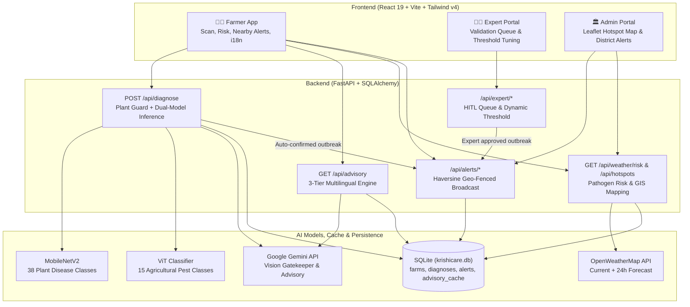

(https://react.dev/)
[](https://pytorch.org/)
[](https://tailwindcss.com/)
[](https://www.sqlite.org/)

---

## 📖 Overview
# 🌾 KrishiCare (KrishiRaksha)

**AI-Powered Crop Disease & Pest Diagnosis, Multilingual Extension Advisory, and Geo-Fenced Outbreak Surveillance Platform**  
*Built for Smart India Hackathon 2026 — Problem Statement 26131*

[](https://fastapi.tiangolo.com/)
[]
**KrishiCare** bridges the gap between field-level crop diagnosis, scientific validation, and regional biosecurity surveillance. Instead of operating as an isolated leaf scanner, KrishiCare connects **three key stakeholders** in a real-time feedback loop:

1. **👨‍🌾 Smallholder Farmers (`/farmer`)**: A mobile-first, multilingual web app (English, Hindi, Marathi, Tamil) to scan diseased leaves or insect pests, receive actionable organic and chemical treatment advisories, monitor hyper-local weather-driven pathogen risk, and receive geo-fenced outbreak alerts from neighboring farms.
2. **👩‍🔬 ICAR Agricultural Scientists (`/expert`)**: A Human-in-the-Loop (HITL) validation workbench where low-confidence AI predictions are queued for expert review, label correction, and agronomist notes—plus live tuning of the global AI confidence threshold.
3. **🏛️ District Agriculture Officers (`/admin`)**: A regional command center featuring an interactive Leaflet geospatial hotspot map, district outbreak KPIs, active expert rosters, and alert escalation/resolution workflows.

---

## ✨ Key Features

### 🔬 1. Tiered Dual-Model AI Inference Pipeline
- **Tier 1 — Leaf Disease Classifier**: Uses `linkanjarad/mobilenet_v2_1.0_224-plant-disease-identification` (MobileNetV2 trained on 38 PlantVillage classes across 14 crops, with automatic fallback to `wambugu71/crop_leaf_diseases_vit`).
- **Crop-Hint Logit Calibration**: When a farmer specifies their crop (e.g., Tomato, Corn, Grape, Potato), the model restricts softmax evaluation to that crop's class subset and calibrates confidence against global probability mass.
- **Tier 2/3 — Agricultural Insect Pest Fallback**: If disease confidence is below `60%`, the crop is uncatalogued, or pest mode is selected, inference cascades to a Vision Transformer (`dima806/farm_insects_image_detection`) covering **15 major agricultural pests** (Fall Armyworms, Aphids, Thrips, Spider Mites, Fruit Flies, Tomato Hornworms, Corn Borers, etc.).
- **Dual-Stage Non-Plant Guard**: Rejects non-vegetation uploads (HTTP `422`) using both a Gemini 1.5 Flash vision gatekeeper and a post-inference statistical filter based on normalized Shannon entropy (`>= 0.72`) and uncalibrated top-1 probability (`< 0.12`).

### 🧑‍🔬 2. Human-in-the-Loop (HITL) Expert Validation
- Configurable **Expert Review Threshold** (`50%–95%`, default `85%`).
- High-confidence predictions (`>= 85%`) are automatically confirmed (`auto_confirmed`), while uncertain cases enter the expert queue (`pending`).
- ICAR scientists can **Approve**, **Reject**, **Override the disease/pest label**, and attach **Agronomist Notes**. Updating the threshold dynamically re-evaluates unfinalized diagnoses in the database.

### 📍 3. Haversine Geo-Fenced Peer Outbreak Alerts
- Whenever a non-healthy diagnosis (`Medium`, `High`, or `Critical` severity) is auto-confirmed or approved by an expert, KrishiCare computes real **Haversine great-circle distances** against all registered farms in the database.
- Farms within the target radius (default `5.0 km`, adjustable up to `20 km` in the farmer UI) automatically receive early-warning alerts.

### 🌐 4. 3-Tier Resilient Multilingual Advisory (`en`, `hi`, `mr`, `ta`)
- Generates concise (<130-word) farmer-friendly advisories covering disease explanation, preventive measures, and both **organic/low-cost** and **chemical** treatments in **English, Hindi (हिंदी), Marathi (मराठी), and Tamil (தமிழ்)**.
- Built for rural/offline reliability using a 3-tier fallback chain:
  1. **SQLite `AdvisoryCache`** (7-day TTL keyed by `disease + crop + lang`)
  2. **Google Gemini LLM Generation**
  3. **Offline Pre-Translated Dictionary Fallback** (ensures zero downtime without internet or API quota)

### 🌦️ 5. Weather-Driven Pathogen Risk Engine
- Integrates with **OpenWeatherMap** (current weather + 24-hour forecast, cached in-memory with a 5-minute TTL and automatic offline mock fallback).
- Calculates a heuristic pathogen risk level (`Low`, `Medium`, `High`, `Critical`) from relative humidity (`>=70%` / `>=85%`), pathogen-favorable temperature windows (`20–30°C`), and precipitation probability.

---

## 🏗️ System Architecture



---

## 🛠️ Tech Stack

| Layer | Technologies |
| :--- | :--- |
| **Frontend** | React 19, Vite 8, Tailwind CSS v4, React Router v7, Axios |
| **Maps & Visualization** | Leaflet 1.9, React-Leaflet v5, Recharts 3 |
| **Internationalization** | `i18next`, `react-i18next` (English, Hindi, Marathi, Tamil) |
| **Backend API** | Python 3.10+, FastAPI, Uvicorn, Pydantic v2, `python-multipart` |
| **Database & ORM** | SQLite (`krishicare.db`), SQLAlchemy 2.0 |
| **Machine Learning** | PyTorch 2.6, Torchvision, HuggingFace `transformers`, Pillow |
| **External APIs** | Google Generative AI (`google-generativeai`), OpenWeatherMap REST API (`httpx`) |
| **Testing** | Playwright E2E verification suite, PyTorch evaluation scripts |

---

## 📂 Repository Structure

```text
KrishiCare/
├── Backend/
│   ├── routes/
│   │   ├── diagnose.py          # POST /api/diagnose, GET /api/history, plant guards
│   │   ├── expert.py            # Expert queue, validation & confidence threshold APIs
│   │   ├── alerts.py            # Haversine peer alerts, district alert resolve/escalate
│   │   ├── advisory.py          # 3-tier multilingual advisory (Cache -> Gemini -> Fallback)
│   │   ├── weather.py           # OpenWeatherMap pathogen risk & /api/hotspots
│   │   └── farms.py             # Farm registration & listing CRUD
│   ├── test_samples/            # Sample leaf images for testing
│   ├── uploads/                 # Persisted scan images served statically at /uploads
│   ├── main.py                  # FastAPI entrypoint, CORS, startup model warm-up
│   ├── ml_inference.py          # Tiered Disease (MobileNetV2) + Pest (ViT) inference engine
│   ├── models.py                # SQLAlchemy ORM models (Farm, Diagnosis, Alert, AdvisoryCache)
│   ├── schemas.py               # Pydantic request/response schemas
│   ├── seed_demo.py             # Database seeder for farms, diagnoses & peer alerts
│   ├── evaluate_model.py        # Model accuracy & inference evaluation script
│   ├── probe_entropy.py         # Shannon entropy calibration utility for non-plant rejection
│   └── requirements.txt         # Python dependencies
└── Frontend/
    ├── src/
    │   ├── api/client.js        # Axios API client for all backend endpoints
    │   ├── components/          # Shared navigation (AdminSidebar, BottomTabBar)
    │   ├── context/             # AuthContext with 1-click demo persona switching
    │   ├── pages/               # Role-specific views (Farmer*, Expert*, Admin*, DiagnoseScan, Login)
    │   ├── App.jsx              # Role-protected routing configuration
    │   └── i18n.js              # Translation dictionaries (en, hi, mr, ta)
    ├── verify-*.js              # Playwright E2E verification scripts
    ├── package.json             # Node dependencies & scripts
    └── vite.config.js           # Vite + Tailwind v4 configuration
```

---


## 👥 Role-Based Portals & Demo Access

The login screen (`/`) provides one-click role switching for demonstrations:

| Role | Demo Persona | Base Route | Key Capabilities |
| :--- | :--- | :--- | :--- |
| **Farmer** | Rajesh Kumar *(Nashik, MH)* | `/farmer` | Leaf/pest camera scan, multilingual advisory (`EN`/`HI`/`MR`/`TA`), local pathogen weather risk, radius-filtered nearby outbreak alerts (`5km`/`10km`/`20km`), farm & scan history |
| **ICAR Expert** | Dr. Priya Sharma *(ICAR Scientist)* | `/expert` | Filter diagnosis queue (`Pending`, `Approved`, `Rejected`, `Auto-Confirmed`), approve/reject/correct AI labels, adjust global AI confidence threshold (`50%–95%`) |
| **District Admin** | Admin Officer *(Maharashtra)* | `/admin` | District surveillance KPIs, interactive Leaflet hotspot map, active scientist roster, district outbreak alert escalation & resolution |

---

## 🔌 API Endpoints Summary

| Method | Endpoint | Description |
| :--- | :--- | :--- |
| `GET` | `/api/health` | Health check and loaded ML model status (`disease_model_loaded`, `pest_model_loaded`) |
| `POST` | `/api/diagnose` | Upload leaf/pest photo (`multipart/form-data` with `image`, `crop_hint`, `mode`, `farm_id`, `latitude`, `longitude`) |
| `GET` | `/api/history` | Retrieve past diagnosis records (optional `farm_id` filter) |
| `GET` | `/api/advisory` | Fetch treatment advisory (`?disease=&crop=&lang=en\|hi\|mr\|ta`) |
| `GET` | `/api/weather/risk` | Compute local weather pathogen risk score (`?lat=&lon=&crop=`) |
| `GET` | `/api/hotspots` | Fetch geo-tagged disease hotspots for the Admin Leaflet map |
| `GET` | `/api/expert/queue` | List diagnoses for expert validation (`?status=pending\|approved\|rejected\|auto_confirmed`) |
| `POST` | `/api/expert/validate` | Approve, reject, or override a pending AI diagnosis and trigger peer alerts |
| `GET/POST` | `/api/expert/threshold` | Get or update the dynamic `EXPERT_REVIEW_THRESHOLD` (`0.50`–`0.95`) |
| `GET` | `/api/expert/list` | Retrieve the active roster of ICAR agricultural specialists |
| `GET` | `/api/alerts` | List district and farm-targeted outbreak alerts |
| `GET` | `/api/alerts/nearby` | Fetch outbreak alerts within `radius` km of a farm |
| `POST` | `/api/alerts/trigger` | Manually trigger Haversine peer alerts for a confirmed diagnosis |
| `POST` | `/api/alerts/{id}/resolve` | Mark a district outbreak alert as `Resolved` |
| `POST` | `/api/alerts/{id}/escalate` | Escalate a critical outbreak alert to the District Agriculture Officer |
| `GET/POST` | `/api/farms` | Register a new farm or list existing farms by district/state |

---

## 🧪 Testing & Verification

- **Backend Model & Entropy Evaluation**:
  ```bash
  cd Backend
  python evaluate_model.py
  python probe_entropy.py
  ```
- **Frontend End-to-End Verification Scripts**:
  With both Backend (`:8000`) and Frontend (`:5173`) running:
  ```bash
  cd Frontend
  node verify-e2e-user-spec.js
  node verify-i18n.js
  node verify-expert-threshold-twoway.js
  node verify-admin-portal.js
  ```
